# Laporan Evidence — Express.js + Prisma CRUD

Laporan pengujian endpoint REST API (`GET`, `POST`, `PUT`, `DELETE`), skenario validasi/error (`400 Bad Request`, `404 Not Found`), serta bukti perubahan pada database SQLite melalui Prisma (`Before` – `After`).

---

## 1. Kondisi Awal Database (Before) & `GET /products`

### A. Database Awal — Before CRUD (`2 rows`)
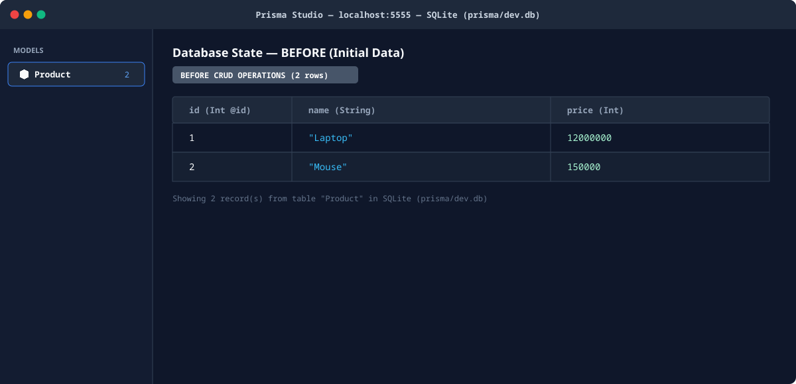

### B. Scenario 1: `GET /products` — Menampilkan Seluruh Data (`200 OK`)
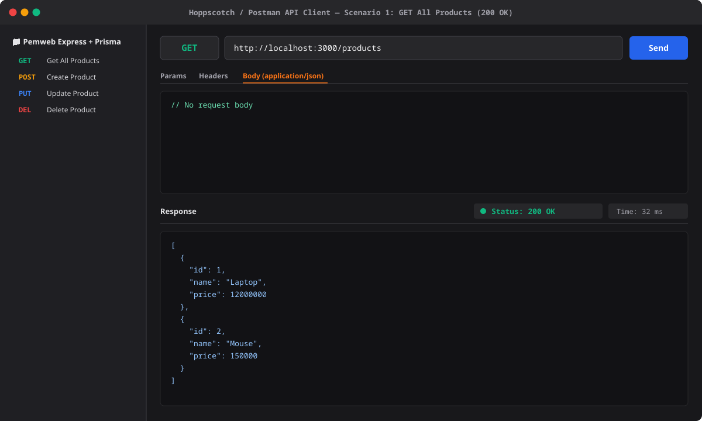

---

## 2. `POST /products` — Membuat Data Baru & Validasi Input

### A. Scenario 2: `POST /products` — Sukses Membuat Produk Baru (`201 Created`)
- **Body:** `{ "name": "Keyboard Mechanical", "price": 350000 }`
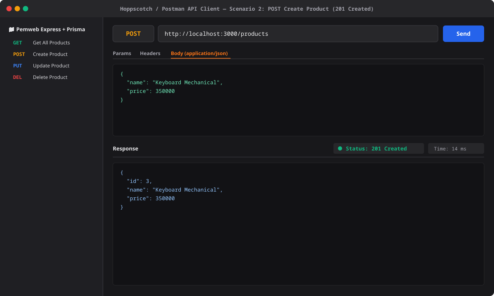

### B. Perubahan Database — After `POST /products` (`id: 3` bertambah)
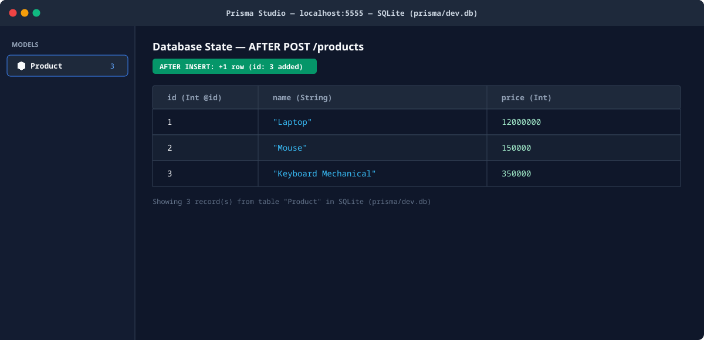

### C. Scenario 3: `POST /products` — Kesalahan Validasi (`400 Bad Request`)
- **Body:** `{ "name": "", "price": "bukan-angka" }`
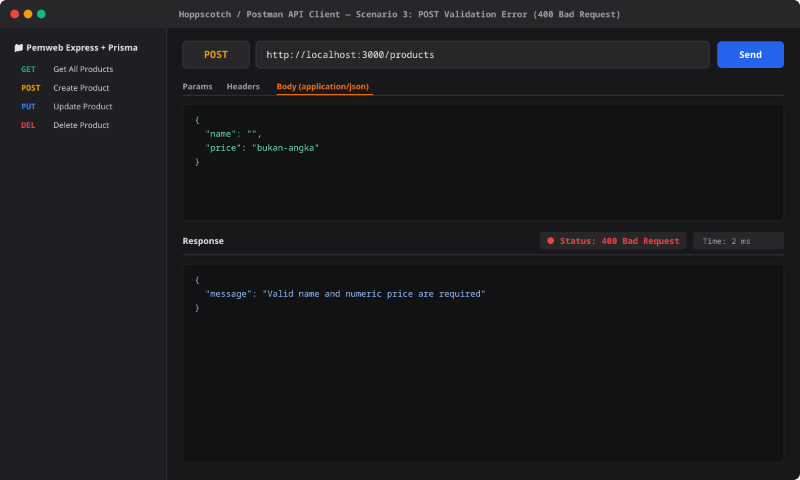

---

## 3. `PUT /products` — Mengupdate Data (`id` di Body) & Penanganan `404`

### A. Scenario 4: `PUT /products` — Sukses Mengupdate Produk (`200 OK`)
- **Body:** `{ "id": 1, "name": "Laptop Gaming ROG", "price": 18500000 }`
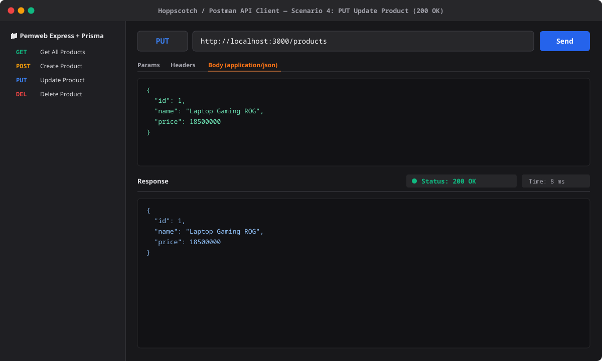

### B. Perubahan Database — After `PUT /products` (`id: 1` terupdate)
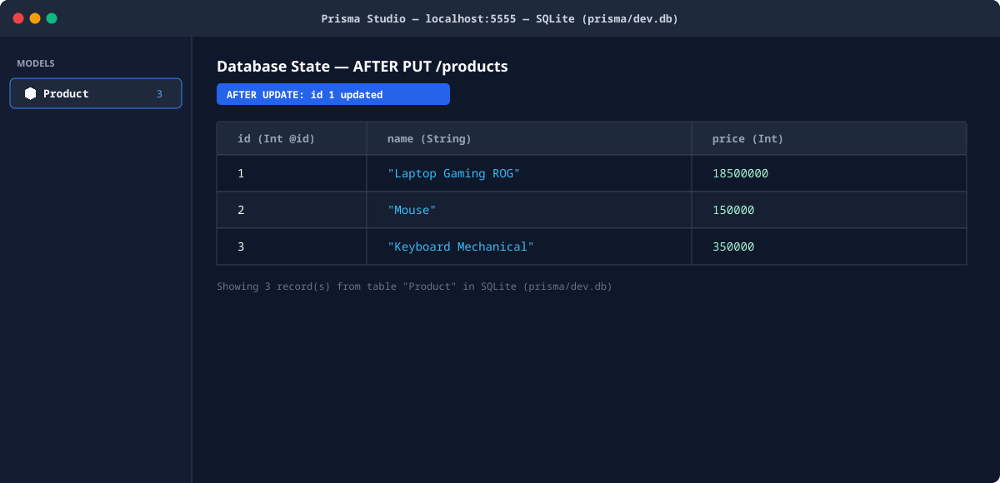

### C. Scenario 5: `PUT /products` — ID Tidak Ditemukan (`404 Not Found`)
- **Body:** `{ "id": 999, "name": "Produk Gaib", "price": 10000 }`
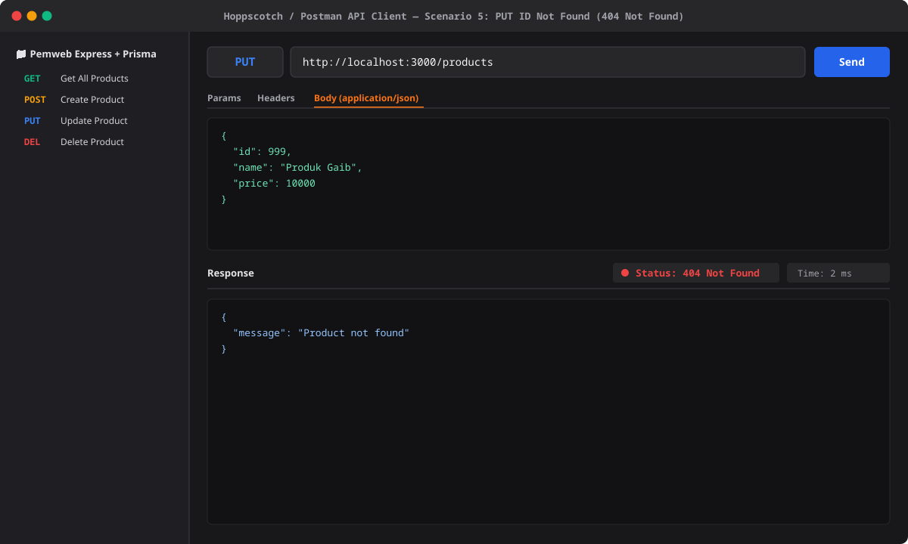

---

## 4. `DELETE /products/:id` — Menghapus Data Berdasarkan ID & Penanganan `404`

### A. Scenario 6: `DELETE /products/2` — Sukses Menghapus Produk (`200 OK`)
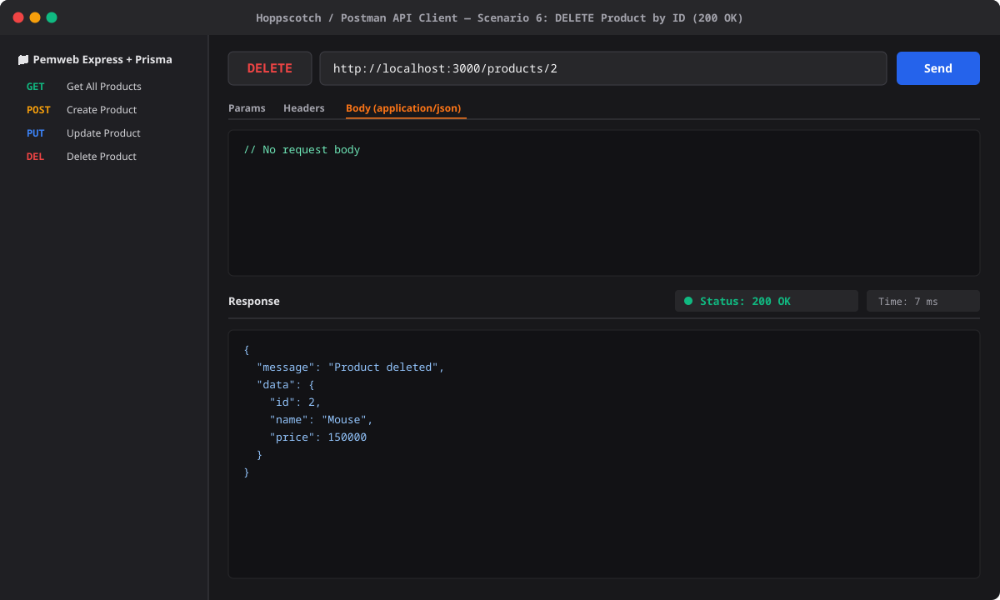

### B. Perubahan Database — After `DELETE /products/2` (`id: 2` terhapus)
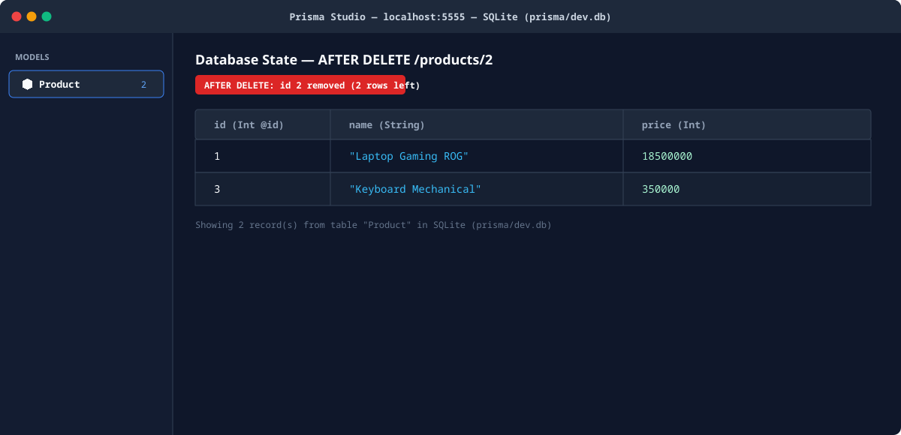

### C. Scenario 7: `DELETE /products/999` — ID Tidak Ditemukan (`404 Not Found`)
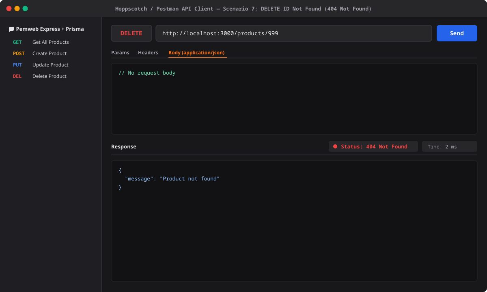
