# Express + Prisma Products CRUD API

Proyek REST API menggunakan **Express.js** dan **Prisma ORM** (SQLite) dengan pemisahan **Route** dan **Controller**.

## Struktur Proyek

```
├── index.js                         # Entry point & konfigurasi Express
├── prisma/
│   └── schema.prisma                # Skema database Prisma (model Product)
├── routes/
│   └── productRoutes.js             # Definisi endpoint /products
├── controllers/
│   └── productController.js         # Logika CRUD dengan PrismaClient
├── test.js                          # Pengujian otomatis (GET, POST, PUT, DELETE, Validasi & 404)
└── README.md
```

## Cara Menjalankan

1. **Install dependencies & sinkronisasi database:**
   ```bash
   npm install
   npx prisma db push
   ```
2. **Jalankan server:**
   ```bash
   npm start
   ```
   Server berjalan di `http://localhost:3000`.
3. **Buka Prisma Studio (untuk screenshot database Before–After):**
   ```bash
   npx prisma studio
   ```
4. **Jalankan pengujian otomatis:**
   ```bash
   npm test
   ```

## Daftar Endpoint

| Method | Endpoint | Body JSON | Deskripsi | Status |
| :--- | :--- | :--- | :--- | :--- |
| `GET` | `/products` | - | Menampilkan seluruh data produk | `200 OK` |
| `GET` | `/products/:id` | - | Menampilkan detail produk berdasarkan `id` | `200 OK` / `404` |
| `POST` | `/products` | `{ "name": "...", "price": 1000 }` | Membuat data produk baru | `201 Created` / `400` |
| `PUT` | `/products` *(atau `/products/:id`)* | `{ "id": 1, "name": "...", "price": 2000 }` | Mengupdate data yang sudah ada | `200 OK` / `400` / `404` |
| `DELETE` | `/products/:id` *(atau `/products`)* | `{ "id": 1 }` *(opsional jika via URL)* | Menghapus data berdasarkan `id` | `200 OK` / `400` / `404` |

## Skenario Pengujian & Bukti (Laporan Evidence)

Seluruh file screenshot tersimpan di folder [`screenshots/`](./screenshots):

### 1. Kondisi Awal Database (Before) & `GET /products` (`200 OK`)
- **Database Before:**
  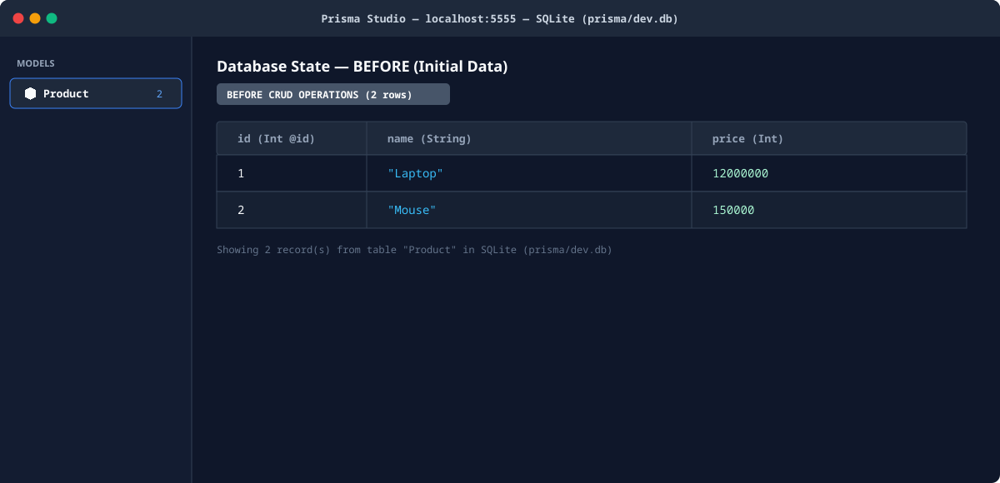
- **GET `/products` (`200 OK`):**
  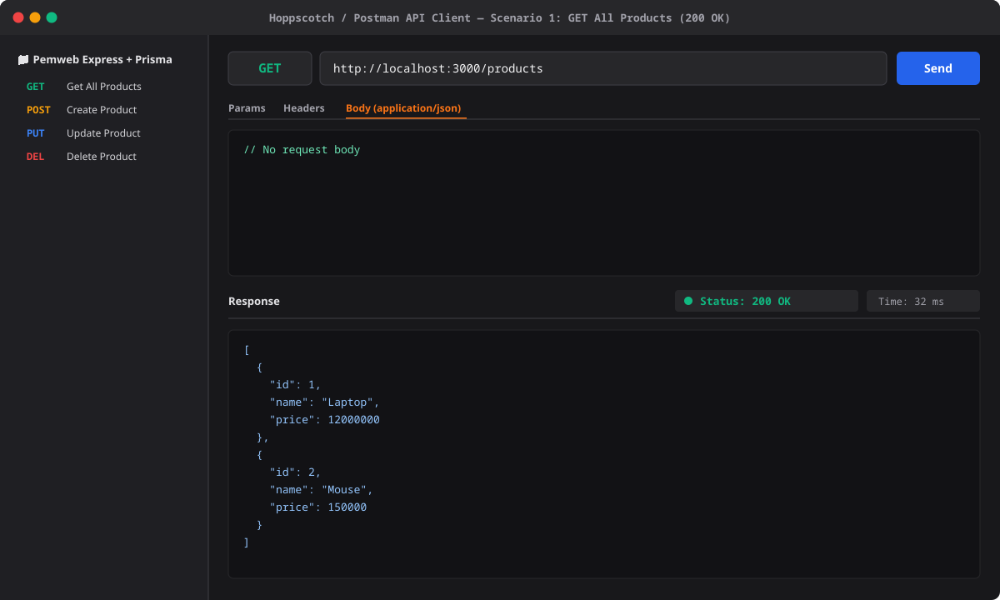

### 2. `POST /products` — Membuat Data Baru (`201`), Database After, & Validasi (`400`)
- **POST `/products` Success (`201 Created`):**
  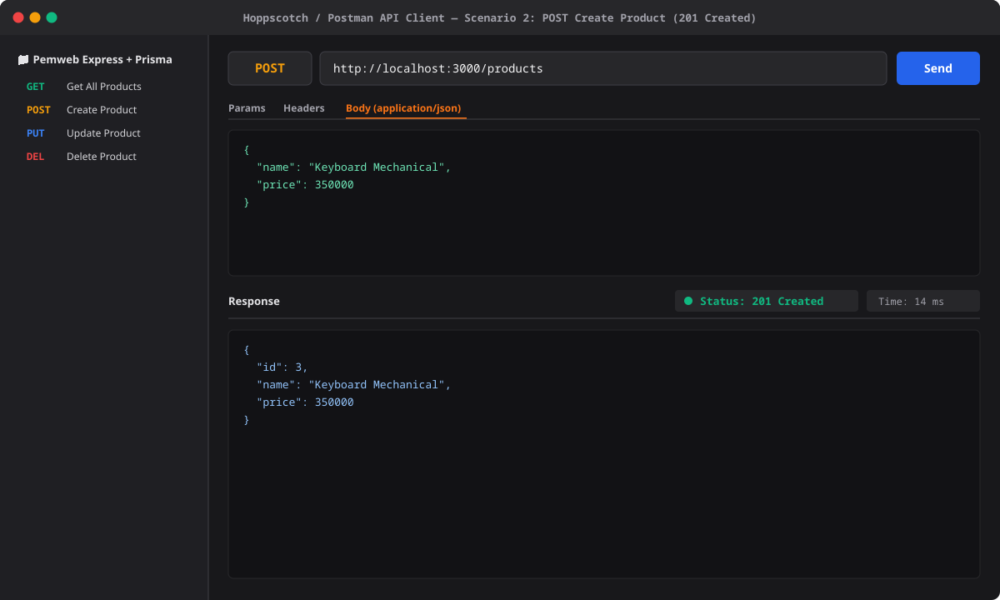
- **Database After POST:**
  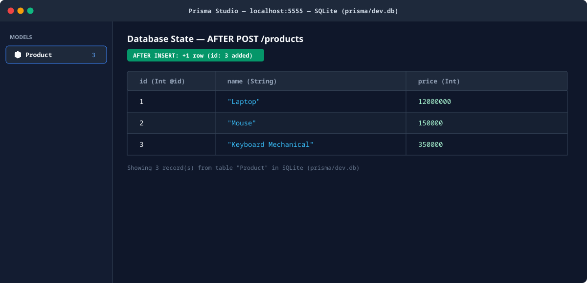
- **POST `/products` Kesalahan Validasi (`400 Bad Request`):**
  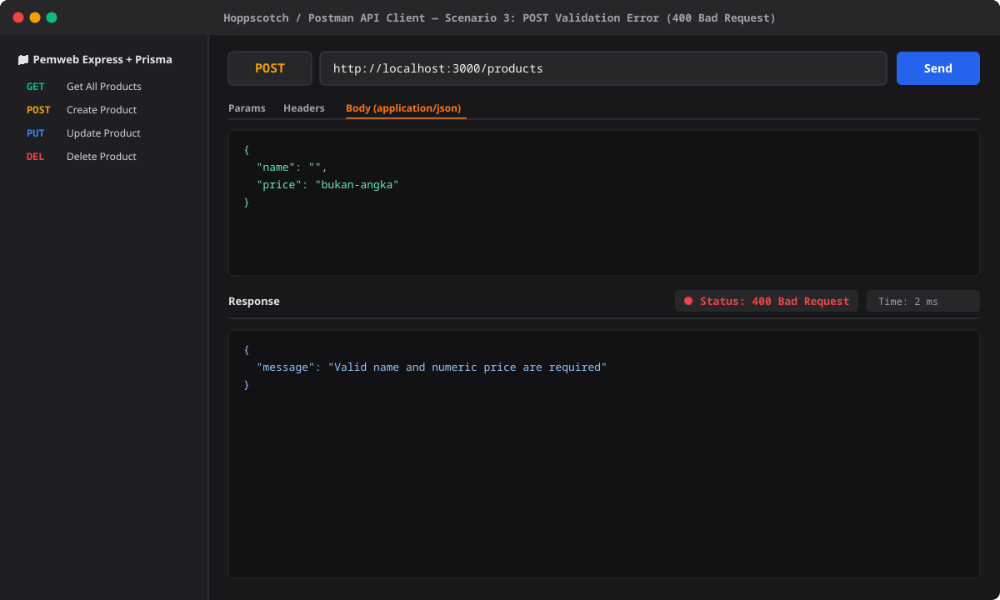

### 3. `PUT /products` — Mengupdate Data (`200`), Database After, & Not Found (`404`)
- **PUT `/products` Success (`200 OK`):**
  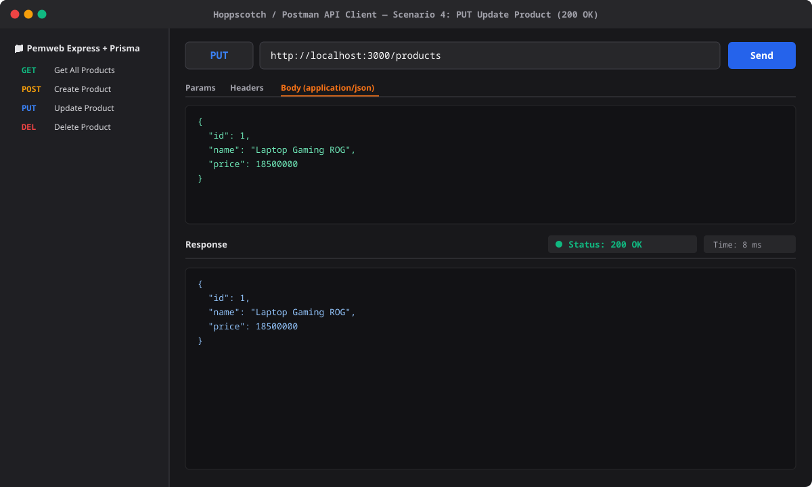
- **Database After PUT:**
  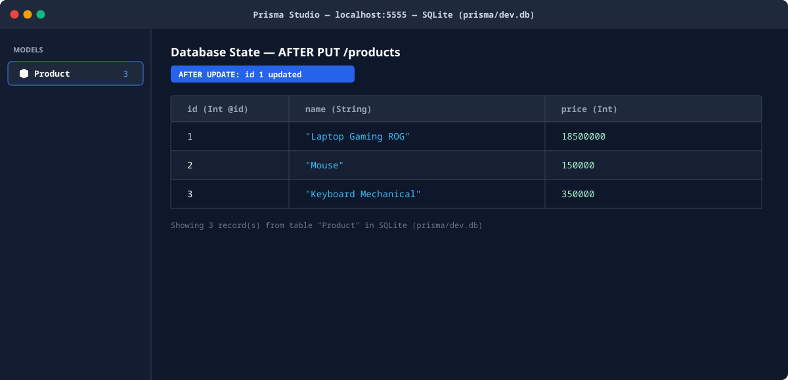
- **PUT `/products` ID Tidak Ditemukan (`404 Not Found`):**
  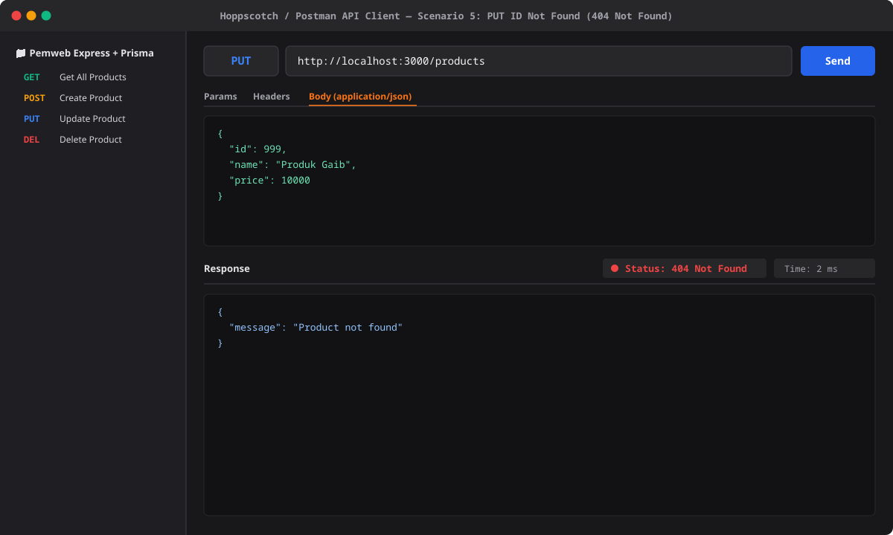

### 4. `DELETE /products/:id` — Menghapus Data (`200`), Database After, & Not Found (`404`)
- **DELETE `/products/2` Success (`200 OK`):**
  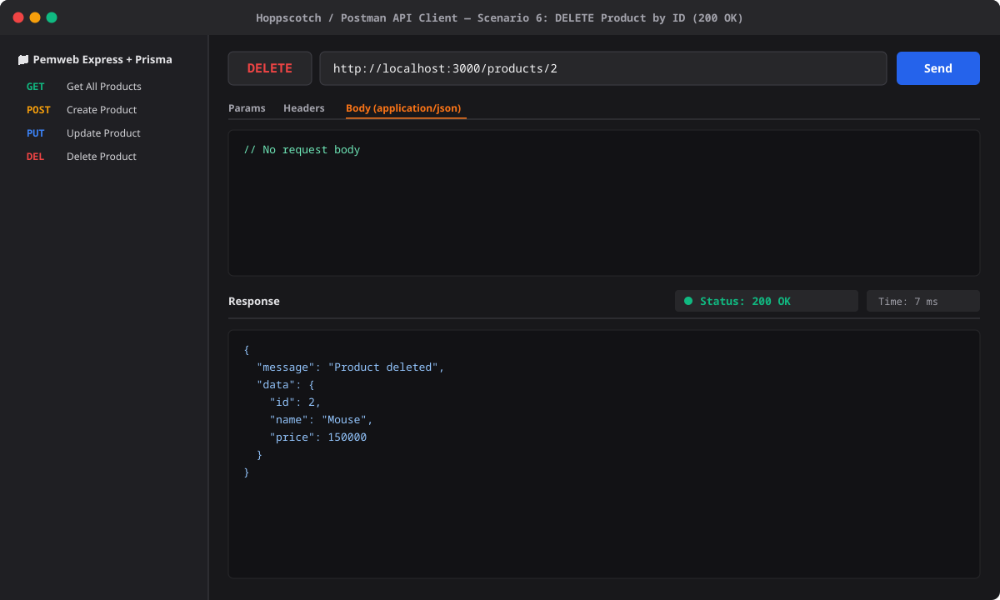
- **Database After DELETE:**
  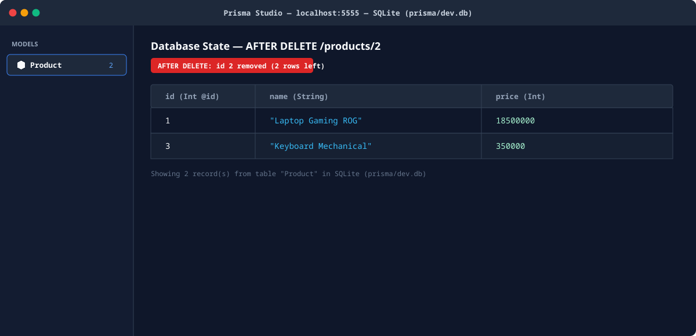
- **DELETE `/products/999` ID Tidak Ditemukan (`404 Not Found`):**
  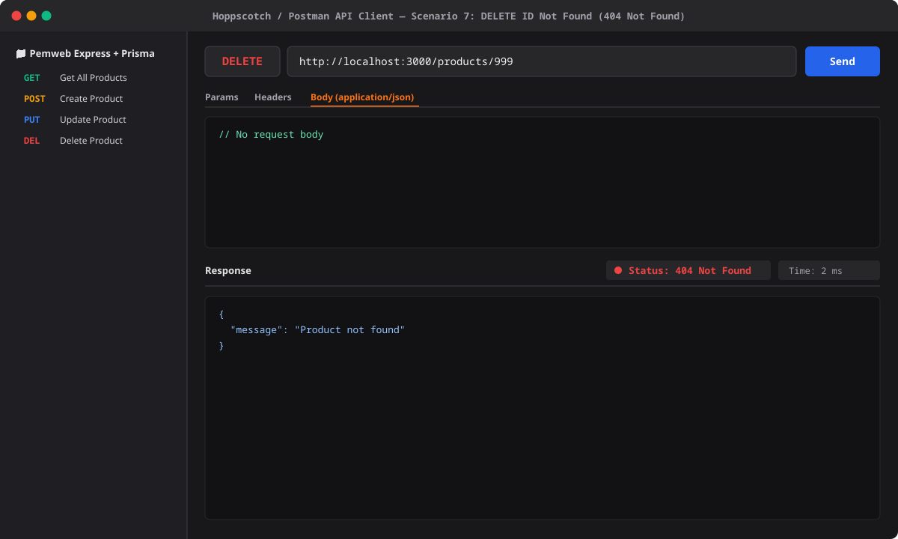
